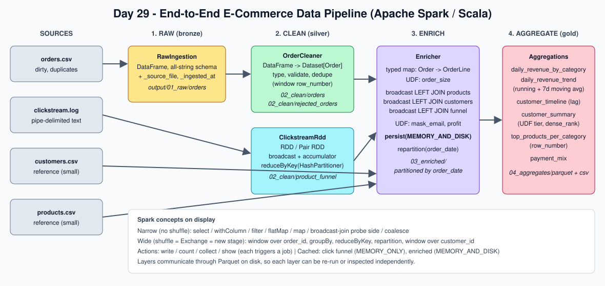
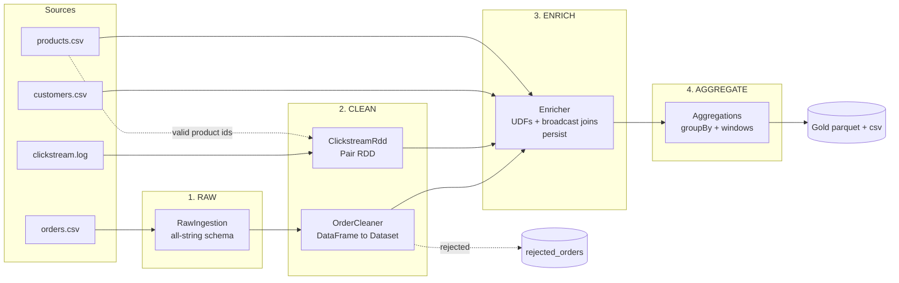

# Day 29 - End-to-End E-Commerce Data Engineering Project (Apache Spark + Scala)

A production-style batch pipeline that turns messy e-commerce files into analytics-ready tables:

**Raw → Clean → Enrich → Aggregate**



| Requirement | Where it lives |
|---|---|
| RDD / Pair RDD component | `raw/ClickstreamRdd.scala` - parse text log, `reduceByKey` with a `HashPartitioner`, broadcast + accumulator |
| DataFrame / Dataset component | `clean/OrderCleaner.scala` (DataFrame → `Dataset[Order]`), `enrich/Enricher.scala` (typed `map`), `aggregate/Aggregations.scala` |
| UDFs | `udf/Udfs.scala` - `order_size`, `customer_tier`, `mask_email` (also registered for Spark SQL) |
| Joins | `Enricher` - three broadcast LEFT joins; `paymentMix` - broadcast cross join |
| Window functions | `row_number` (dedupe, top-N), `dense_rank`, `lag`, running `sum`, 7-day moving `avg` |
| Partitioning | `HashPartitioner`, `repartition(col)`, `partitionBy("order_date")` output, `coalesce(1)` for reports |
| Persistence | `MEMORY_ONLY` (funnel RDD), `MEMORY_AND_DISK` (enriched DataFrame) + Parquet layers |
| Aggregations | `groupBy/agg`, `countDistinct`, windowed aggregates |
| Testing | ScalaTest: unit tests + an end-to-end test on the sample data |

---

## Architecture



Layers talk through Parquet on disk (`output/01_raw` → `02_clean` → `03_enriched` → `04_aggregates`), so each
layer can be inspected or re-run on its own.

| Layer | Input | What happens | Output |
|---|---|---|---|
| **Raw** | `orders.csv` | Read with an explicit all-string schema (dirty values can't break the read); add `_source_file`, `_ingested_at` | `01_raw/orders` |
| **Clean (DataFrame)** | raw orders | Trim/normalise, cast types, 7 validation rules, keep latest row per `order_id`; **nothing is silently dropped** - bad rows go to a rejected table with a reason and the raw JSON | `02_clean/orders`, `02_clean/rejected_orders` |
| **Clean (RDD)** | `clickstream.log` | Parse lines, drop malformed ones (accumulator counts them), filter unknown products (broadcast set), sum (views, carts, purchases) per product | `02_clean/product_funnel` |
| **Enrich** | clean orders + dims + funnel | typed `Order → OrderLine`, `order_date`, `is_revenue`, UDFs, 3 broadcast left joins, profit, PII masking; **persisted** | `03_enriched/order_date=…/` |
| **Aggregate** | enriched | 6 gold tables (below) | `04_aggregates/parquet/*` and `04_aggregates/csv/*` |

Gold tables: `daily_revenue_by_category`, `daily_revenue_trend`, `customer_timeline`, `customer_summary`,
`top_products_per_category`, `payment_mix`.

### Sample data (deliberately dirty)

`data/raw/orders.csv` has 26 rows: 18 good orders plus a duplicate `order_id`, a missing `order_id`, a negative
quantity, a non-numeric price, an unparseable timestamp, an invalid status, a missing customer, and one order
for an unknown product (valid - it must survive as `UNKNOWN`). One order (`O1016`) belongs to a customer who is
not in `customers.csv`. `clickstream.log` has 4 bad lines (no delimiters, unknown event, empty product, unknown product).

---

## Run it

Requirements: **JDK 11, 17 or 21** (not 8) and [sbt](https://www.scala-sbt.org/).

```bash
sbt test                                   # unit + end-to-end tests
sbt run                                    # runs on data/raw, writes ./output
sbt "run --input data/raw --output output --shuffle-partitions 8 --explain true --show true"
```

Options: `--input`, `--output`, `--master` (default `local[*]`), `--shuffle-partitions`, `--explain`, `--show`.
While a run is in progress the Spark UI is at <http://localhost:4040> (Jobs / Stages / Storage / SQL tabs).

---

## Spark concepts, as used in this project

Full walkthrough with per-component tables: [`docs/SPARK_INTERNALS.md`](docs/SPARK_INTERNALS.md).

**Transformations (lazy) vs actions (run a job)**

| Component | Transformations (lazy) | Action that triggers the work |
|---|---|---|
| Clickstream RDD | `textFile`, `flatMap`, `map` *(narrow)*; `reduceByKey` *(wide)* | writing the funnel to Parquet (also `collect()` of product ids) |
| Clean | `select`, `withColumn`, `filter` *(narrow)*; `row_number().over(...)` *(wide)* | `write.parquet` (valid and rejected) |
| Enrich | typed `map`, `withColumn`, `join(broadcast(...))` | `enriched.count()` (fills the cache), then `write.parquet` |
| Aggregate | `groupBy/agg`, window functions | `write.parquet`, `write.csv`, `show` |

**Stages and shuffles.** A new stage starts at every shuffle (`Exchange`). Shuffles in this project:
`reduceByKey` (RDD), the dedupe window on `order_id`, every `groupBy`, the windows over `customer_id`/`country`/
`category`, `repartition(...)`. The broadcast joins add **no** shuffle on the order side. Use `--explain true`
(prints `explain("formatted")` and the RDD lineage via `toDebugString`) and the Spark UI **SQL / Stages** tabs to see
the exact stage layout for your Spark version - adaptive execution (AQE) may merge or coalesce shuffle partitions.

**Optimizations applied**

1. **Broadcast joins** for small dimensions - the large order side is never shuffled.
2. **`reduceByKey(partitioner, f)`** instead of `groupByKey` or `partitionBy` + `reduceByKey` - map-side combine, one shuffle.
3. **Explicit schemas** - no extra pass over files for schema inference; all-string raw read can't fail on bad data.
4. **`spark.sql.shuffle.partitions=8`** (default 200 is wasteful locally) + **AQE** enabled.
5. **Persist only what is reused**: enriched data feeds ~8 jobs → `MEMORY_AND_DISK`; the funnel RDD is tiny → `MEMORY_ONLY`; both unpersisted afterwards.
6. **`repartition(order_date)` before `partitionBy("order_date")`** to avoid many small files per folder; **`repartition(customer_id)`** before the customer window so the partitioning can be reused.
7. **Parquet** between layers - columnar, compressed, supports column pruning.
8. **Left joins + `UNKNOWN` defaults** so orders with unknown products/customers are not silently lost from revenue.

**Trade-offs worth knowing**

- UDFs and typed `Dataset.map` lambdas are opaque to Catalyst (no push-down, per-row serialization). They are used
  here to demonstrate them; in production prefer built-in column expressions where they can express the rule.
- `coalesce(1)` CSV reports are only OK for small tables.
- The un-partitioned window in `daily_revenue_trend` collapses to one partition - fine for one row per day.
- The cleaned `valid` and `rejected` outputs are computed by two write jobs (cheap here because raw is re-read from Parquet).
- Accumulators updated in transformations can over-count on task retries - used for monitoring only.

---

## Expected results (hand-derived from the sample data)

Pipeline summary: raw **26** → clean **19** + rejected **7** (`MISSING_ORDER_ID`, `MISSING_CUSTOMER_ID`,
`INVALID_QUANTITY`, `INVALID_PRICE`, `INVALID_TIMESTAMP`, `INVALID_STATUS`, `DUPLICATE_ORDER_ID`, one each);
6 products in the funnel; 4 rejected click lines.

`daily_revenue_trend` (revenue = COMPLETED + SHIPPED only):

| order_date | revenue | cumulative_revenue |
|---|---|---|
| 2026-09-01 | 596.49 | 596.49 |
| 2026-09-02 | 245.00 | 841.49 |
| 2026-09-03 | 211.00 | 1052.49 |
| 2026-09-04 | 1139.00 | 2191.49 |
| 2026-09-05 | 250.00 | 2441.49 |
| 2026-09-06 | 571.99 | 3013.48 |
| 2026-09-07 | 1044.00 | 4057.48 |

Customer `C001`: total spend 1131.00 → tier **GOLD**, rank 1 in `IN`; running spend 50 → 170 → 1069 → 1131.
Funnel for `P100`: 2 views, 1 cart, 2 purchases.

---

## Testing

`sbt test` runs (local Spark, no cluster needed):

| Suite | Covers |
|---|---|
| `UdfsSpec` | UDF logic boundaries, null-safe masking (plain Scala, no Spark) |
| `PipelineConfigSpec` | CLI parsing |
| `ClickstreamRddSpec` | line parser, Pair-RDD funnel sums, accumulator count |
| `OrderCleanerSpec` | typing/normalisation, every reject reason, keep-latest dedupe |
| `PipelineIntegrationSpec` | full run on `data/raw`: layer counts, revenue total, UNKNOWN handling, window results, UDF tier, dense_rank |

## Project layout

```
Day29-End-to-End-E-Commerce-Project/
├── build.sbt, project/build.properties
├── data/raw/                 orders.csv, customers.csv, products.csv, clickstream.log
├── docs/                     architecture.svg, SPARK_INTERNALS.md
├── scripts/push_to_github.sh
└── src/
    ├── main/scala/com/ecommerce/
    │   ├── Main.scala, Pipeline.scala
    │   ├── config/ model/ common/ udf/ output/
    │   ├── raw/        RawIngestion, ClickstreamRdd
    │   ├── clean/      OrderCleaner
    │   ├── enrich/     Enricher
    │   └── aggregate/  Aggregations
    └── test/scala/com/ecommerce/   *Spec.scala
```

## Ideas to extend

Incremental loads (partition overwrite by date), Delta/Iceberg tables, Structured Streaming for the clickstream,
data-quality thresholds that fail the job, spark-submit packaging with `sbt-assembly`.
